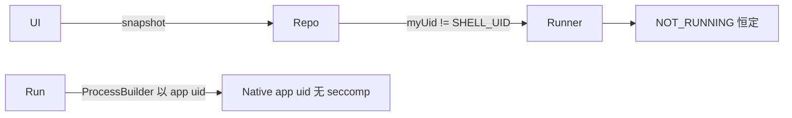
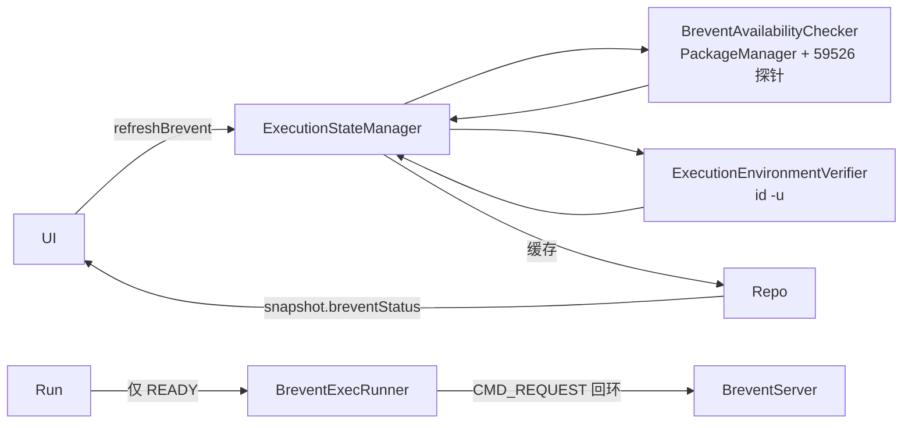

# Brevent 诚实集成计划（2026-10-17）

## 现状与基线

- 分支 `main`；基线 commit `89c7d76`（`fix: drop Shizuku, rebrand to Brevent`）。
  工作树干净，无未提交改动。
- 现场设备：Redmi Note 13 5G（MT6833，Android 15，kernel
  `6.6.118-android15-8-ge56cfb09cca-ab15511674-4k`），包名 `com.ghostlock.app`。
  已授予 `android.permission.WRITE_SECURE_SETTINGS`。
- 现状 UI 错误：Brevent 卡固定显示「Run via Brevent / Start Brevent, then return here」
  加感叹号，Run 按钮恒灰。

已知三处实现缺陷（都在 `app/src/main/kotlin/com/ghostlock/app/brevent/BreventExploitRunner.kt`）：

1. `status()`（第 22-30 行）用 `Process.myUid() != Process.SHELL_UID` 判断。它读的是
   GhostLock 自己的 uid（app uid），永远不等于 `SHELL_UID`(2000)，因此永远返回
   `NOT_RUNNING`，与 Brevent 是否安装、是否运行无关。
2. `requestPermission()`（第 32-34 行）只调用 `statusListener`，没有任何真实授权接口。
3. `run()`（第 83 行）用 `ProcessBuilder(argv)` 直接在 app 进程 uid 下启动 native，
   不是 shell uid，也没有 seccomp 绕过；`--enable-status-record` 的 ACK 写入的是
   本地 `Process.outputsStream`，不是 Brevent 通道。

## Brevent 公开接口事实（来自 vendor 开源模块与 wiki）

`BreventUI` 的 `brevent-protocol` 模块（master，v2.8.6，本地克隆
`/tmp/opencode/brevent-src`）给出以下**本仓库可作为外部契约依赖**的事实：

- 包名 `me.piebridge.brevent`。
- Activity `me.piebridge.brevent.ui.BreventCmd` 处理
  `me.piebridge.brevent.intent.action.COMMAND`，附带 extra
  `me.piebridge.brevent.intent.extra.COMMAND`。语义是**fire-and-forget**：没有退出码、
  没有 stdin/结果通道；命令在 Brevent UI 进入后台时被杀；`&`、裸 `sh`/`su` 被拒绝；
  root 模式会用 `id` 替换命令（老版本）或走 `su shell`（2.8.3+）。
- 回环 TCP 协议：端口 `59526`（`BaseBreventProtocol.PORT`），仅 loopback。报文 =
  2 字节大端长度前缀 + `Parcel` 序列化 + gzip。action 枚举：
  `STATUS_REQUEST=0, STATUS_RESPONSE=1, CMD_REQUEST=12, CMD_RESPONSE=13,
  BASE_STATUS_OK=99`。裸 `writeShort(0)` 后读到 `BreventOK`（长度为 1 的帧）表示
  「服务器在运行」（`BreventProtocol.checkPortSync`）。
- 协议受 token 门禁：token 只通过一个带
  `android:permission="android.permission.DEVICE_POWER"` 的 receiver 广播下发。
  该权限 protection level 是 `signature`，第三方 app **不可能**持有；
  `BreventBinderProvider` 同样受 `DEVICE_POWER` 门禁。
- 协议 version 字段应等于 Brevent 自身的 `versionCode`（vendor 用
  `BuildConfig.VERSION_CODE`）；不匹配服务端会拒绝，所以客户端必须读取已安装
  Brevent 的 `longVersionCode` 填入。
- `CMD_RESPONSE` 携带 `request/output/done/remain/token`；客户端按 `remain==0` 决定
  是否继续请求下一段输出，`done!=0` 表示命令结束。响应可能回传新 token，需回填。

**结论（必须诚实反映在状态里）**：第三方 app 走回环命令通道大概率被 token/DEVICE_POWER
拒绝。因此 READY 必须建立在「实际跑通一条命令并读到 shell uid」之上，否则只能给出
`AUTHORIZATION_REQUIRED` / `EXECUTION_UNAVAILABLE`，并把用户引向直连模式。

## 目标与约束

目标：

- 状态、权限、连接、执行、错误五项全部基于**真实可观测证据**，不再有假 READY、假授权。
- READY 仅当：命令通道可用 **且** 运行时 `id -u` 返回 `0` 或 `2000`。
- 提供诊断模式与可复制诊断日志，明确写出每项结论与证据来源。
- Brevent 不可用时，Run 按钮禁用并给出**具体原因**，引导到直连模式或打开 Brevent。
- UI 生命周期正确：启动、开关切换、`onResume`（从 Brevent 返回）都重新检测。

非目标：

- 不新增任何隐藏 API、越权、漏洞利用或安全绕过。
- 不修改 `src/core/`（native 攻击路径）任何代码，不改 GLK1 wire 与 profile 格式。
- 不新增 Android 权限；不请求或伪造 `DEVICE_POWER`。
- 不宣称支持任何新内核；不改 `kernelsnitch/`、`LegacyProfileConverter.kt`。
- 不保证 Brevent 4.x 命令通道一定可用（证据只来自 v2.8.6 开源模块与 wiki）。

## 改动清单

| 文件 | 改动 | 理由 |
|---|---|---|
| `app/src/main/kotlin/com/ghostlock/app/brevent/BreventProtocol.kt`（新增） | 回环协议客户端：`Parcel` 编解码、gzip 帧、`checkPortSync` 探针、`sendCommand` 流式收发（含 remain/done/token）、version/token 处理 | 唯一能诚实判定「服务器在运行 / 命令可执行」的公开接口 |
| `app/src/main/kotlin/com/ghostlock/app/brevent/BreventCommandBackend.kt`（新增） | `interface BreventCommandBackend` + `BreventSocketBackend`：`probeServer()`、`verifyEnvironment()`、`run(command, ...)` | 隔离可测接口，UI 不直接碰 socket |
| `app/src/main/kotlin/com/ghostlock/app/brevent/BreventAvailability.kt`（新增） | 纯数据 `BreventAvailability`、`BreventAuthorization`、`BreventEnvironment`，以及纯函数 `BreventReadiness.resolve(...)` | 状态判定可脱离 Android 单测 |
| `app/src/main/kotlin/com/ghostlock/app/brevent/BreventAvailabilityChecker.kt`（新增） | 用 `PackageManager` 查安装/版本/`ACTION_COMMAND` 可解析性，调 backend 探测服务器 | 采集「安装/服务」证据 |
| `app/src/main/kotlin/com/ghostlock/app/brevent/ExecutionEnvironmentVerifier.kt`（新增） | 通过 backend 执行 `id -u`，判定授权与 uid，产出 `BreventEnvironment` | READY 的运行时证据 |
| `app/src/main/kotlin/com/ghostlock/app/brevent/ExecutionStateManager.kt`（新增） | 组合 checker+verifier，缓存最近一次结果，产出 `BreventStatus` 与 `BreventDiagnostics` | 单一状态权威，避免 UI 各算各的 |
| `app/src/main/kotlin/com/ghostlock/app/brevent/BreventExecRunner.kt`（重命名自 `BreventExploitRunner.kt`） | 删除假 `status()/requestPermission()`；改为经 backend 下发执行脚本（内容经 base64 内联，避免依赖 app 私有目录被 shell 读写），流式收集输出、解析 `GHOSTLOCK_EXIT:`，仅在已 READY（已验 uid）时启动 | 让 Brevent 执行路径真实、可诊断、失败可解释 |
| `app/src/main/kotlin/com/ghostlock/app/brevent/BreventScript.kt`（新增） | 纯函数：把 profile blob / 环境变量 / dump 目录拼成可在 shell 跑的脚本字符串（含 base64 引号与转义） | 可单测，避免 shell 注入 |
| `app/src/main/kotlin/com/ghostlock/app/domain/model/GhostlockModels.kt` | 扩展 `BreventStatus`；新增 `BreventDiagnostics`（含 `format()` 纯文本报告） | 公共数据结构，UI/VM/测试共享 |
| `app/src/main/kotlin/com/ghostlock/app/domain/repository/GhostlockRepository.kt` | 删除 `requestBreventPermission()`、`setBreventStatusListener(...)`；新增 `suspend fun refreshBrevent(): BreventStatus`、`suspend fun breventDiagnostics(): BreventDiagnostics`、`suspend fun openBreventIntent(): Boolean` | 与真实能力对齐 |
| `app/src/main/kotlin/com/ghostlock/app/data/AndroidGhostlockRepository.kt` | 用 `ExecutionStateManager` 替换 `breventRunner.status()`；`snapshot()` 读缓存；开关打开触发展开检测；新增诊断/刷新实现 | 接入新状态机 |
| `app/src/main/kotlin/com/ghostlock/app/ui/GhostlockViewModel.kt` | `onStatusClick` 改为打开 Brevent 状态对话框；新增 `onBreventRetry/onOpenBrevent/onCopyBreventDiagnostics/onBreventDialogDismiss`；`onInit/onResume` 刷新；Run 门禁与提示按新状态 | 用户可见行为 |
| `app/src/main/kotlin/com/ghostlock/app/ui/GhostlockUI.kt` | Brevent 卡摘要按新状态；新增 `BreventStatusDialog`（状态/原因/版本/证据 + Open Brevent / Check Again / Copy / Close） | 诊断模式入口 |
| `app/src/main/kotlin/com/ghostlock/app/ui/MainActivity.kt` | `onResume` 触发刷新；`OpenBrevent` 已有，保留；新增处理复制诊断 | 生命周期 |
| `app/src/main/res/values/strings.xml`、`values-zh/strings.xml` | 更新/新增状态与诊断文案（中英同步） | 双语约定 |
| `app/src/test/kotlin/com/ghostlock/app/brevent/BreventReadinessTest.kt`（新增） | 状态机全转移单测 | 验证矩阵 |
| `app/src/test/kotlin/com/ghostlock/app/brevent/BreventProtocolTest.kt`（新增，Robolectric） | 帧/gzip/Parcel 往返、version/token 布局、`BreventOK` 判定、真假服务器回环收发 | 验证矩阵 |
| `app/src/test/kotlin/com/ghostlock/app/brevent/BreventScriptTest.kt`（新增） | 脚本拼装与转义单测 | 验证矩阵 |

## 数据流/控制流差异

旧：



新：



不变量：

- `BreventStatus.READY` 当且仅当「服务器探针成功」**且**「运行时命令返回 shell/root uid」。
- 未检测完成（`CHECKING`）或不可用时，`runExploitWithBrevent` 不启动任何进程。
- 任何一次检测都不写文件系统之外的状态；不改 profile/wire。

## 状态机

```
NOT_REQUIRED        开关关闭
NOT_INSTALLED       未安装 Brevent
SERVICE_NOT_RUNNING 已安装，59526 无应答
CHECKING            正在检测
AUTHORIZATION_REQUIRED 服务在，命令通道被拒（token/DEVICE_POWER）
EXECUTION_UNAVAILABLE  服务在且通道未明确拒绝，但 uid 验证失败/输出不可解析
READY               通道可用且 uid ∈ {0, 2000}
ERROR               探针抛出非预期异常
```

`BreventReadiness.resolve` 优先级：`!selected → NOT_REQUIRED`；`checking → CHECKING`；
`error != null → ERROR`；`!installed → NOT_INSTALLED`；`!serverRunning → SERVICE_NOT_RUNNING`；
`authorization==DENIED → AUTHORIZATION_REQUIRED`；
`authorization==GRANTED && uid∈{0,2000} → READY`；否则 `EXECUTION_UNAVAILABLE`。

## 兼容性与回滚

- 无 wire/profile/native 改动，旧 profile 与 GLK1 blob 完全不变。
- `GhostlockRepository` 接口删除两个方法、新增三个，编译期即可发现遗漏调用点。
- 回滚：`git revert` 本批次提交，恢复 `BreventExploitRunner`；无数据迁移、无持久化格式变化
  （偏好键 `brevent_enabled`/`brevent_explicit` 与原样保留）。

## 验证矩阵

| 批次 | 命令 | 预期 |
|---|---|---|
| 1 诊断/状态机 | `./gradlew :app:testDebugUnitTest` | 新增 3 个测试类全绿，既有测试不回归 |
| 2 UI/仓库接线 | `./gradlew :app:assembleDebug` | 编译通过、零新增告警 |
| 3 文档 | 本计划 + `AGENTS.md` 若需同步 | 结构图/描述与实现一致 |

真机门禁**无法执行**（当前环境无设备）：59526 探针与命令通道授权只能尽力检测并在
诊断日志中标注证据来源与不确定性；不得据此声称「真机验证通过」。

## 明确保留

- `src/core/**`：完全不动（攻击关键路径）。
- GLK1 wire 与 HOCON profile 格式：不动；键名 `recommend_shizuku` 逐字保留。
- `kernelsnitch/`、`LegacyProfileConverter.kt`、`prebuilt profile` 入口：不动。
- 直连模式（`runExploit` / `runExploitBinary`）：行为不变。
- 偏好键与 profile 建议逻辑（PROFILE-SUGGEST-01）：语义不变。

## 进度

- [x] Explore（代码 + Brevent 公开接口）
- [ ] Design（本文件，待用户认可）
- [ ] Implement 批次 1：协议/状态机/脚本 + 单测
- [ ] Implement 批次 2：仓库/VM/UI/字符串
- [ ] Verify：`testDebugUnitTest` + `assembleDebug`
